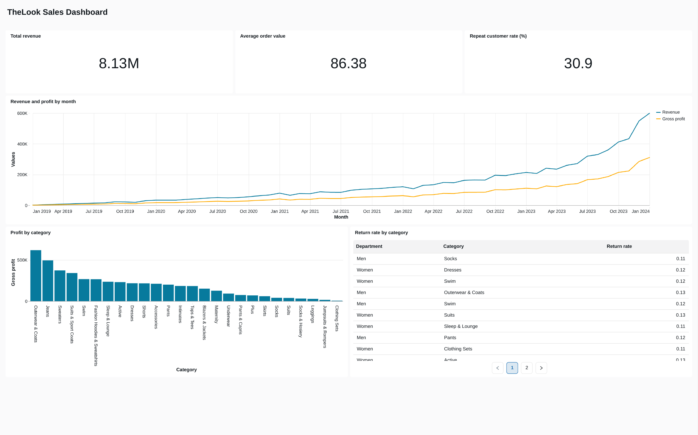
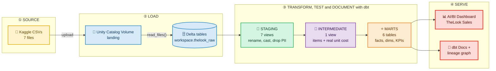
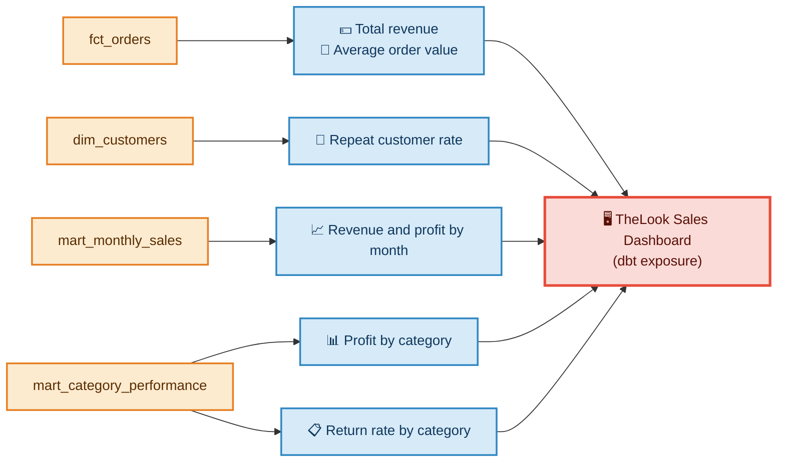
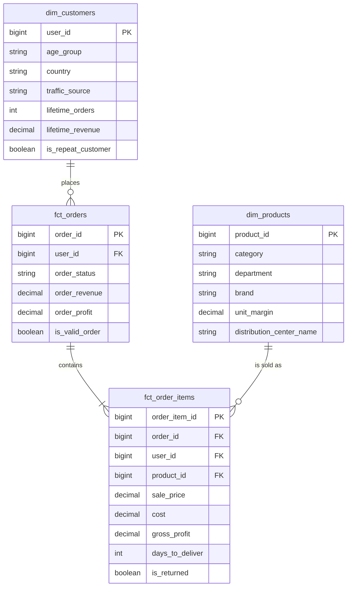

<div align="center">

# 🛍️ TheLook E-Commerce Analytics

### Raw CSVs → tested dbt models → a live Databricks dashboard

*A production-style analytics engineering project: 7 raw tables, a star schema, 38 data tests, documented models and an AI/BI dashboard, all built with dbt on Databricks.*


<br>



*The finished AI/BI dashboard, built directly on the dbt marts.*

</div>

---

## ⚡ 30-second summary

| | |
|---|---|
| **What** | An end-to-end analytics pipeline for a fictional online clothing shop (TheLook, by the Looker team) |
| **Input** | 7 raw CSV tables: orders, items, products, customers, inventory, distribution centers, web events |
| **Output** | A star schema, three business-ready marts and a published dashboard |
| **Trust** | 38 automated tests on every build; every mart model and key column documented |
| **Headline result** | **$8.13M** revenue · **$86.38** average order value · **30.9%** of customers buy again |

---

## 🎯 The business problem

The raw data is spread across 7 tables with generic column names and loose types (prices are inferred as floating point, customer PII sits next to purchase data). Three teams need numbers they can trust:

| 👥 Team | ❓ Question | 📦 Answered by |
|---|---|---|
| 💰 **Finance** | How are revenue, gross profit and average order value trending? | `mart_monthly_sales` |
| 🧵 **Merchandising** | Which categories make the most profit, and which get returned most? | `mart_category_performance` |
| 📣 **Marketing** | How many customers come back to buy again? | `dim_customers` |

---

## 🗺️ Pipeline at a glance



**Stack:** dbt Core 1.12 · Databricks (Unity Catalog, serverless SQL warehouse) · SQL · Jinja · Python/uv · Git + GitHub pull requests

---

## 📊 The dashboard

Built in Databricks AI/BI and declared as a [dbt exposure](looker_ecommerce/models/marts/_exposures.yml), so the dashboard appears in the lineage graph and dbt knows which models it depends on.

| Widget | Source model | Answers |
|---|---|---|
| 3 KPI counters | `fct_orders`, `dim_customers` | Revenue, average order value, repeat-customer rate |
| Revenue and profit by month | `mart_monthly_sales` | Is the business growing? |
| Profit by category | `mart_category_performance` | Where does the money come from? |
| Return rate by category | `mart_category_performance` | Which products come back? |



---

## 🏗️ Data model (star schema)



Two more marts sit on top of the star schema: **`mart_monthly_sales`** (grain: one row per month) and **`mart_category_performance`** (grain: one row per department and category).

### Model layers

| Layer | Materialization | Models | Purpose |
|---|---|---|---|
| 🟢 **staging** | view | `stg_thelook__*` (7) | 1:1 cleanup: rename keys, cast money to `DECIMAL`, drop PII |
| 🟣 **intermediate** | view | `int_order_items__enriched` | Join items with the real unit cost and product attributes |
| 🟠 **marts** | table | `fct_order_items`, `fct_orders`, `dim_customers`, `dim_products`, `mart_monthly_sales`, `mart_category_performance` | Star schema and business KPIs |

---

## 🔍 Key insights

> Every number below comes from the models in this repo and is visible in the dashboard above.

- 🏆 **Outerwear & Coats is the most profitable category**, with about **$619K** gross profit across the men's and women's departments.
- 🔄 **Return rates are remarkably uniform** (10.8%–13.2% across all categories), so returns are not driven by category. Profit margin varies far more (37%–62%).
- 💰 **Valid orders generated $8.13M** in revenue at an average order value of **$86.38**.
- 🔁 **30.9% of customers who ordered came back** for at least one more order.
- 📈 **Revenue and profit grow steadily from 2019 to 2024**, with the steepest climb in the most recent months.

---

## ✅ Data quality

**38 tests run on every `dbt build`, all passing:**

- 🔑 `unique` + `not_null` on every primary key
- 🔗 `relationships` between items, orders, products, inventory and users
- 🏷️ `accepted_values` on order status, driven by a single project variable
- 🧪 Singular test: an item is never delivered before it was shipped
- 🛡️ `unique` on fact keys as a fan-out guard; fact row count reconciled against staging

---

## 🧠 Design decisions (the "why")

<details>
<summary><b>Why take cost from <code>inventory_items</code> instead of <code>products</code>?</b></summary>

Each unit sold has its own real cost. Using the catalogue cost would restate historical profit every time a price changes. `fct_order_items.gross_profit` uses the cost of the unit actually sold.
</details>

<details>
<summary><b>How is fan-out (double counting) avoided?</b></summary>

Items are rolled up to order grain **before** joining to orders, and the fact keys are tested with `unique`. The grain is stated in a comment at the top of every model.
</details>

<details>
<summary><b>What counts as a "valid order"?</b></summary>

An order that is not Cancelled or Returned. `is_valid_order` is defined **once** in `fct_orders` and reused by every revenue KPI, so Finance and Marketing never disagree on the definition.
</details>

<details>
<summary><b>Why <code>DECIMAL(10,2)</code> for money?</b></summary>

The raw prices were inferred as `DOUBLE`. Casting to a fixed-precision decimal avoids floating-point drift in sums.
</details>

<details>
<summary><b>How is PII handled?</b></summary>

Names, email and street address are dropped in staging, so they never reach any downstream model or the dashboard.
</details>

<details>
<summary><b>Why views for staging and tables for marts?</b></summary>

Staging and intermediate are cheap, always-fresh views. Marts are tables so the dashboard queries stay fast. Each layer lives in its own schema, configured once at folder level in `dbt_project.yml`.
</details>

<details>
<summary><b>How is repeated logic avoided?</b></summary>

A Jinja macro (`count_orders_by_status`) generates one count column per order status from `var('order_statuses')`. The same variable drives the `accepted_values` tests. The refactor was verified with a before/after `EXCEPT` comparison.
</details>

<details>
<summary><b>How is the documentation kept alive?</b></summary>

Models and key columns carry descriptions in YAML, which `dbt docs generate` turns into a browsable site with a lineage graph. The dashboard is declared as a dbt exposure, so it appears in that lineage too.
</details>

---

## 🚀 How to run it

```bash
git clone https://github.com/swadeshpanda/Thelook-ecommerce-dbt-databricks.git
cd Thelook-ecommerce-dbt-databricks
uv sync                                   # installs dbt-core + dbt-databricks
```

1. **Load the raw data:** run [`setup/01_load_raw.sql`](setup/01_load_raw.sql) in a Databricks SQL editor (CSV → Unity Catalog volume → Delta tables via `read_files`). It is safe to re-run.
2. **Connect dbt:** add a `looker_ecommerce` profile to `~/.dbt/profiles.yml` (type `databricks`, catalog `workspace`, your host and HTTP path, token via `env_var('DATABRICKS_TOKEN')`).
3. **Build:**

```bash
cd looker_ecommerce
dbt deps
dbt build                                  # run models + all 38 tests
dbt docs generate && dbt docs serve        # browse docs and the lineage graph
```

| Raw table | Rows |
|---|---|
| orders | 125,226 |
| order_items | 181,759 |
| users | 100,000 |
| events | 2,431,963 |

---

## 📁 Repository structure

```text
.
├── setup/
│   └── 01_load_raw.sql              # reproducible raw-data load
├── docs/images/                     # README images
└── looker_ecommerce/                # the dbt project
    ├── dbt_project.yml              # layer rules, schemas, variables
    ├── packages.yml                 # dbt_utils
    ├── macros/                      # count_orders_by_status
    ├── tests/                       # singular data tests
    └── models/
        ├── staging/                 # 7 views + sources + tests
        ├── intermediate/            # reusable joins
        └── marts/                   # facts, dims, KPI marts, exposure
```

---

## 🛣️ Roadmap

- [ ] Incremental `fct_events` model (merge strategy) for the large events table
- [ ] Snapshot of product prices (SCD Type 2)
- [ ] Unit tests for gross profit logic
- [ ] CI with GitHub Actions on every pull request

---

## 🙌 Credits

- 📚 **Based on:** DataCamp's *Case Study: Building E-Commerce Data Models with dbt*
- 🔧 **Rebuilt on:** Databricks (Unity Catalog, serverless SQL warehouse)
- ➕ **Extended with:** Unity Catalog loading, a star schema, data quality checks, documentation and an AI/BI dashboard
- 🗃️ **Data:** TheLook eCommerce dataset (Looker / Google), via Kaggle

<div align="center">

### 👤 Built by Swadesh Ranjan Panda

[](https://github.com/swadeshpanda)

*If this project was useful or interesting, a ⭐ on the repo is appreciated.*

</div>
